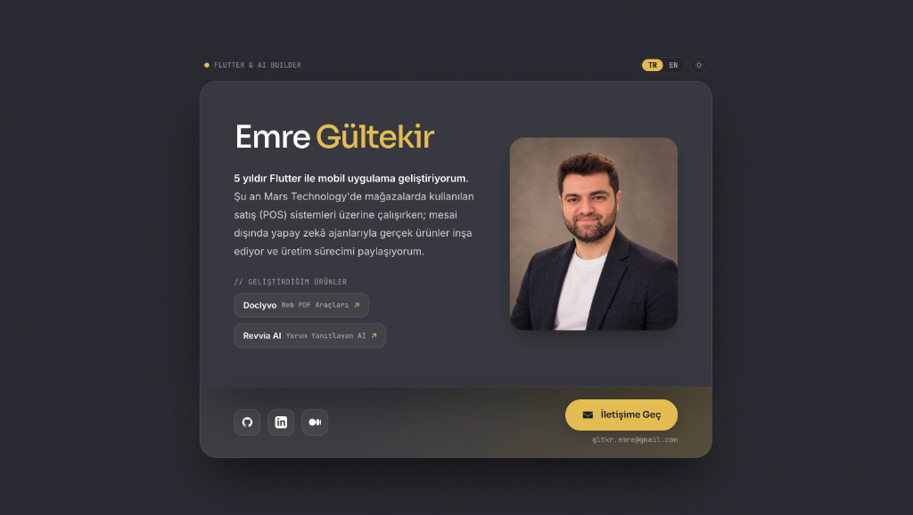

<div align="center">

# My Carrd — Kişisel Portfolyo & Açık Kaynak Şablon 🚀

[**English**](README.md) · **Türkçe**

<br />

<p align="center">
  
</p>

[](https://emre-gultekir-card.web.app)
[](LICENSE)
[](https://github.com/E-MRE/my-carrd)

</div>

---

[Carrd Template #318](https://bb17e50b963c5e74.demo.carrd.co) estetiğinden ilham alan, iki dilli (**TR / EN**), **Açık / Koyu tema** destekli, bağımsız ürün üreten yazılım geliştiricileri için tasarlanmış modern kişisel portfolyo şablonu.

Bu proje, tek bir `site.config.js` dosyasını düzenleyerek dakikalar içinde kendi adınıza yayına alabileceğiniz açık kaynaklı, tam dinamik bir şablondur. Sıfır kurulum (`zero-build`), sıfır npm bağımlılığı!

---

## ✨ Özellikler

* **🎨 Carrd #318 Orijinal İki Panelli Düzen:** Üstte cam yüzeyli kimlik, biyografi ve proje rozetleri; altta açılı gradyanlı sosyal bağlantılar ve sürtünmesiz iletişim butonu.
* **⚡ Sıfır Kurulum & Build Bağımlılığı:** `npm install` veya karmaşık paketleyicilere gerek yok. Saf, ultra hızlı HTML, CSS ve JavaScript.
* **⚙️ Merkezi Yapılandırma (`site.config.js`):** Ad, soyad, biyografi, durum rozeti, fotoğraf, ürünler, e-posta, sosyal linkler ve **tema renkleri** tek bir dosyadan yönetilir.
* **🎨 Dinamik Tema Renk Yönetimi:** Hardcoded renk yok! Dark ve Light temaların arkaplan, kenarlık, metin ve vurgu (accent) renklerini konfigürasyon dosyasından kolayca değiştirebilirsiniz.
* **🌐 Çift Dilli Altyapı (TR / EN):** Tek tıkla diller arası kesintisiz geçiş. Son seçim `localStorage` üzerinde hatırlanır; sayfa başlığı ve meta etiketleri dinamik güncellenir.
* **💼 Proof-of-Work Proje Rozetleri:** Geliştirdiğiniz SaaS, açık kaynak ve bağımsız projeleri biyografinin hemen altında mikro kartlar olarak sergiler.
* **📬 Sürtünmesiz Akıllı İletişim (Smart CTA):** "İletişime Geç" butonu hem e-posta adresini panoya kopyalar (`✓ E-posta kopyalandı!`) hem de e-posta uygulamasını açar. Buton altında doğrudan adres şeffafça görünür.
* **♿ WCAG AA Uyumlu & Tamamen Duyarlı (Responsive):** Mobilde ve masaüstünde mükemmel oranlar; 44px erişilebilir dokunma hedefleri.

---

## 🚀 3 Adımda Kendinize Uyarlayın

### 1. Projeyi Klonlayın veya Fork Edin
```bash
git clone https://github.com/E-MRE/my-carrd.git
cd my-carrd
```

### 2. `site.config.js` Dosyasını Kendi Bilgilerinizle Düzenleyin
`site.config.js` dosyasını favori metin düzenleyicinizde açın:

```javascript
// site.config.js
const siteConfig = {
  // 1. Profil ve İletişim
  profile: {
    avatar: "assets/profile.jpg", // veya harici resim URL'si
    email: "eposta@adresiniz.com"
  },

  // 2. Tema ve Renkler (İstediğiniz renk kodlarını verin)
  theme: {
    defaultTheme: "dark", // "dark" veya "light"
    dark: {
      accent: "#E3BD52",  // Vurgu rengi
      pageBg: "#22222A",
      // ...
    },
    light: {
      accent: "#D97706",
      pageBg: "#EDEDF2",
      // ...
    }
  },

  // 3. Sosyal Ağlar (github, linkedin, medium, twitter, x, instagram, youtube, website)
  social: [
    { name: "GitHub", url: "https://github.com/kullaniciadi", icon: "github" },
    { name: "LinkedIn", url: "https://linkedin.com/in/kullaniciadi", icon: "linkedin" },
    { name: "Medium", url: "https://medium.com/@kullaniciadi", icon: "medium" }
  ],

  // 4. Çift Dilli İçerik (TR / EN)
  i18n: {
    defaultLang: "tr",
    tr: {
      roleBadge: "FLUTTER & AI BUILDER",
      firstName: "Adınız",
      highlightName: "Soyadınız",
      bioLead: "5 yıldır Flutter ile mobil uygulama geliştiriyorum.",
      bioBody: "Şu an şirketimde çalışırken, mesai dışında yapay zekâ ürünleri geliştiriyorum.",
      projectsLabel: "// GELİŞTİRDİĞİM ÜRÜNLER",
      projects: [
        { title: "Doclyvo", tag: "Web PDF Araçları", url: "https://proje1.com" },
        { title: "Revvia AI", tag: "Yorum Yanıtlayan AI", url: "https://proje2.com" }
      ],
      ctaText: "İletişime Geç",
      copiedToast: "✓ E-posta kopyalandı!"
    },
    en: {
      // İngilizce karşılıkları...
    }
  }
};
```

### 3. Tarayıcınızda Doğrudan Açın & İnceleyin
```bash
open index.html
```

---

## 🌐 Ücretsiz Yayına Alma (1 Dakikada Deploy)

Statik dosyalardan oluştuğu için sunucu veya backend maliyeti olmadan anında canlıya alabilirsiniz:

* **Firebase Hosting:**
  ```bash
  firebase deploy --only hosting
  ```
* **GitHub Pages:** Repository Ayarları > *Pages* > Branch olarak `main` ve kök dizini (`/`) seçin.
* **Vercel / Netlify / Cloudflare Pages:** Depoyu bağlayın; herhangi bir derleme komutu (build command) olmadan anında deploy edilir.

---

## 📂 Dosya Yapısı

```
my-carrd/
├── assets/
│   ├── preview.png   # README ekran görüntüsü
│   └── profile.jpg   # Profil portre fotoğrafı
├── site.config.js    # 🎯 TEK BİLGİ KAYNAĞI: Tüm metinler, linkler ve renkler
├── index.html        # Semantik, temiz şablon iskeleti
├── styles.css        # Carrd #318 cam & gradyan tasarım sistemi (CSS Değişkenleri)
├── app.js            # Tema token enjektörü, dil motoru ve akıllı CTA etkileşimi
├── preview.html      # Önizleme dosyası
├── README.md         # İngilizce dokümantasyon
├── README.tr.md      # Türkçe dokümantasyon
└── LICENSE           # MIT Lisansı
```

---

## 📝 Lisans

Bu proje [MIT Lisansı](LICENSE) altında açık kaynak olarak sunulmaktadır. Dilediğiniz gibi kullanabilir, kopyalayabilir ve kişiselleştirebilirsiniz.
